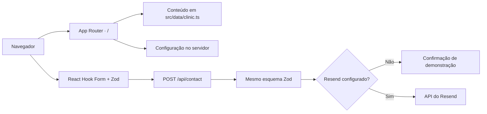

# Arquitetura da Aurora

A aplicação tem uma landing page e um endpoint de contato. Os componentes são renderizados no servidor por padrão. Menu, animação de entrada na área visível, carrossel, FAQ e formulário usam componentes cliente por dependerem de eventos, estado ou APIs do navegador.

## Fluxos principais

A página aguarda `connection()` para ler as variáveis de contato por requisição. O formulário recebe um booleano para representar o modo demonstração. A chave do Resend, o remetente e o destinatário ficam no servidor. O link do WhatsApp é público quando configurado.

O interesse em um tratamento é transportado pelo parâmetro `interesse` e pela âncora `#contato`. Depois da hidratação, o formulário confere o valor com a lista de tratamentos e usa o resultado para preencher uma mensagem editável. Para o contrato do envio, consulte a [API de contato](api-contato.md).

## Mapa do código

| Arquivo | Responsabilidade e ponto de extensão |
| --- | --- |
| [`app/layout.tsx`](../src/app/layout.tsx) | HTML raiz em pt-BR, fontes locais com `next/font`, metadata, Open Graph e canonical. |
| [`app/page.tsx`](../src/app/page.tsx) | Ordem das seções, âncora de início, link de salto e configuração de contato por requisição. |
| [`app/globals.css`](../src/app/globals.css) | Tokens, composições mobile-first, estados de foco e interação e redução de movimento. |
| [`app/icon.svg`](../src/app/icon.svg) e [`opengraph-image.jpg`](../src/app/opengraph-image.jpg) | Favicon e imagem de compartilhamento reconhecidos pelas convenções de arquivos do Next.js. |
| [`app/api/contact/route.ts`](../src/app/api/contact/route.ts) | Limite do corpo, validação, resposta demonstrativa e integração server-side com o Resend. |
| [`data/clinic.ts`](../src/data/clinic.ts) | Crédito público de autoria, navegação, tratamentos, jornada, equipe, depoimentos e FAQ. |
| [`layout/brand.tsx`](../src/components/layout/brand.tsx) | Marca e link de retorno ao início. O texto visual também participa do nome acessível. |
| [`layout/header.tsx`](../src/components/layout/header.tsx) | Cabeçalho fixado durante a rolagem, navegação desktop e botão de menu mobile. Escape fecha o menu e devolve o foco ao botão. |
| [`layout/footer.tsx`](../src/components/layout/footer.tsx) | Navegação complementar, canais demonstrativos e crédito ao autor. |
| [`sections/hero.tsx`](../src/components/sections/hero.tsx) | Título, chamadas para ação e imagem prioritária na primeira dobra. |
| [`sections/treatments.tsx`](../src/components/sections/treatments.tsx) | Cards e links de interesse. O mapa local associa os identificadores do conteúdo aos ícones Lucide. |
| [`sections/about.tsx`](../src/components/sections/about.tsx) | História conceitual, fotografia da recepção e diferenciais. |
| [`sections/experience.tsx`](../src/components/sections/experience.tsx) | Jornada em lista ordenada. A ordem dos ícones acompanha a sequência de etapas do conteúdo. |
| [`sections/team.tsx`](../src/components/sections/team.tsx) | Retratos otimizados e áreas de atuação de profissionais fictícios. |
| [`sections/testimonials.tsx`](../src/components/sections/testimonials.tsx) | Carrossel manual e circular. A região viva anuncia o depoimento quando a pessoa navega pelos controles. |
| [`sections/faq.tsx`](../src/components/sections/faq.tsx) | Perguntas centralizadas no conteúdo e respostas abertas pelo Accordion. |
| [`sections/contact.tsx`](../src/components/sections/contact.tsx) | Texto contextual, canais de contato e montagem do formulário. |
| [`sections/contact-form.tsx`](../src/components/sections/contact-form.tsx) | Campos, preenchimento por interesse, validação, chamada HTTP e retorno acessível ao visitante. |
| [`ui/accordion.tsx`](../src/components/ui/accordion.tsx) | Composição shadcn/ui adaptada. Radix gerencia expansão, foco e teclado e o CSS define a apresentação. |
| [`ui/reveal.tsx`](../src/components/ui/reveal.tsx) | Motion inicia uma animação curta uma vez por bloco. O HTML inicial permanece legível antes da hidratação. |
| [`lib/contact-schema.ts`](../src/lib/contact-schema.ts) | Esquema Zod compartilhado entre navegador e servidor, mensagens de validação e tipo inferido. |
| [`lib/contact-config.ts`](../src/lib/contact-config.ts) | Leitura da configuração do Resend e montagem da URL autorizada do WhatsApp. |
| [`lib/utils.ts`](../src/lib/utils.ts) | Combina classes condicionais com clsx e resolve conflitos Tailwind com tailwind-merge. |

## Decisões de interface

- Os tokens em `:root` são a fonte para cores e superfícies. `@theme inline` expõe os tokens e as fontes que integram o Tailwind.
- O layout começa em uma coluna. Grades e menus mudam de composição em 540 e 851 px. A jornada só ganha quatro colunas a partir de 1120 px para comportar os títulos.
- A imagem do hero usa prioridade alta e um atributo `sizes` que acompanha a largura da composição. As imagens abaixo da dobra usam carregamento tardio. As caixas com proporção definida reservam espaço antes do carregamento.
- O carrossel exige interação explícita. O FAQ usa controles nativos via Radix e o formulário associa avisos de validação aos campos. As transições respeitam `prefers-reduced-motion`.
- As imagens em [`public/images`](../public/images) são WebP gerados com ImageGen para este projeto. O briefing pediu um consultório iluminado em travertino, uma recepção em madeira e três retratos distintos de profissionais fictícios em creme e oliva, sem marcas ou texto.

## Configuração do projeto

[`package.json`](../package.json) mantém scripts, runtimes aceitos e dependências. [`package-lock.json`](../package-lock.json) fixa a árvore de resolução usada por `npm ci`. [`tsconfig.json`](../tsconfig.json) habilita a checagem estrita e o alias `@/`. [`next.config.ts`](../next.config.ts) mantém os ajustes do framework. [`postcss.config.mjs`](../postcss.config.mjs) ativa o Tailwind e [`eslint.config.mjs`](../eslint.config.mjs) carrega as regras do Next.js. [`components.json`](../components.json) descreve o estilo e os aliases da integração shadcn/ui.

A [integração contínua](../.github/workflows/ci.yml) instala a árvore do lockfile e valida lint, TypeScript e build em Node.js 22 e 24. O [Dependabot](../.github/dependabot.yml) verifica atualizações do npm e do GitHub Actions semanalmente.
